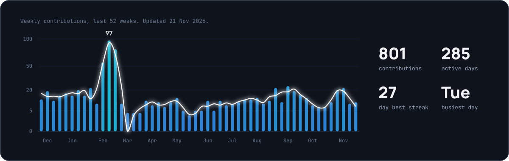

<sub><b>Fig. 1.</b> An illustrative near-infrared spectrum with the broad O-H and C-H bands of plant material, sampled at seven wavelengths, standardized, and read by a small network that returns one number. Most of my work happens somewhere along that line.</sub>

I studied chemistry at the University of Sri Jayewardenepura and wrote my thesis on docking libraries of small molecules against dengue virus targets. That thesis is where I started writing software to do the science for me, and I haven't stopped. Right now I'm an intern data scientist at [SpectrifyAI](https://spectrify.ai), building models that predict tea chemistry from near-infrared spectra.

[Email](mailto:narankotuwadilshan@gmail.com) &ensp;/&ensp; [LinkedIn](https://www.linkedin.com/in/dilshan-narankotuwa) &ensp;/&ensp; [Portfolio](https://personal-portfolio-zeta-coral.vercel.app)

## From the bench to the model

**Chemistry taught me not to trust a single measurement.** You calibrate, run a blank, repeat, and only then believe the number. I still work that way. A held-out test set is just a control I set up before I'm allowed to look.

**My thesis moved the bench into a terminal.** Docking whole ligand databases meant scripting the chemistry, so I built bridge tools that run RDKit and AutoDock Vina inside Galaxy.

**Then my laptop died halfway through.** Instead of buying a new one, I built a computer: a Raspberry Pi 5 tablet that slots into a wooden briefcase and becomes a laptop. It runs AutoDock Vina at about 15 ligands an hour.

**Now both halves meet in one job.** At SpectrifyAI I train models that read near-infrared spectra and predict tea chemistry, make them hold up when a sample is measured on a different instrument, and help put them into the company's web app.

```math
\begin{array}{ll}
\textit{science} & A(\lambda) = \varepsilon(\lambda)\, b\, c \\[6pt]
\textit{software} & \mathbf{x} = \mathrm{SNV}\big(\mathrm{d}A/\mathrm{d}\lambda\big) \\[6pt]
\textit{intelligence} & \hat{c} = f_{\theta}(\mathbf{x})
\end{array}
```

<sub><b>Eq. 1.</b> The Beer-Lambert law links what is in a sample to the light it absorbs. Preprocessing turns that light into clean features, and a trained model reads the concentration back out.</sub>

## Experiments

Written up the way I'd log them at the bench: the question, what I did, and where it stands.

### [Galaxy Bridge Tool](https://github.com/DilshanNarankotuwa/Galaxy-Bridge-Tool)

**Question.** Can a whole ligand library be docked against a protein in one Galaxy run, instead of one molecule at a time?<br>
**What I did.** Wrapped RDKit and AutoDock Vina in a Galaxy tool that docks every ligand in parallel across all CPU cores, ranks the poses by score, and converts the best ones with Open Babel.<br>
**Where it stands.** Thesis prototype, demonstrated on dengue virus targets.

<kbd>Python</kbd> <kbd>RDKit</kbd> <kbd>AutoDock Vina</kbd> <kbd>Open Babel</kbd> <kbd>Galaxy</kbd>

### [Pi Machine](https://github.com/DilshanNarankotuwa/Galaxy-Pi-Project)

**Question.** My laptop died mid-thesis. Could I build something cheaper that would keep the docking going?<br>
**What I did.** Designed a Raspberry Pi 5 tablet with its own battery pack that docks into a handmade wooden briefcase with a 15.6 inch screen and a keyboard.<br>
**Where it stands.** Built and documented, with the parts list, power design and assembly guide.

<kbd>Raspberry Pi 5</kbd> <kbd>18650 cells</kbd> <kbd>Raspberry Pi OS</kbd> <kbd>AutoDock Vina</kbd> <kbd>PyMOL</kbd>

### [GigaHz](https://github.com/DilshanNarankotuwa/GigaHz)

**Question.** Can a parts shop stop people from buying a PC build that won't work?<br>
**What I did.** Built a React and Express app on PostgreSQL that checks every pick against hardware rules (CPU socket, RAM type, power supply wattage, form factor) and only offers parts that fit the build so far.<br>
**Where it stands.** [Live demo](https://gigahz-demo.vercel.app), and over 80 stars on the repository.

<kbd>React</kbd> <kbd>Node.js</kbd> <kbd>Express</kbd> <kbd>PostgreSQL</kbd> <kbd>Vercel</kbd>

**Also on the bench.** [Laptop price predictor](https://github.com/DilshanNarankotuwa/Laptop_Price_Predictor): four regressors compared on 1,303 laptops, a random forest tuned with grid search to an R² of 0.78 on held-out data, served from a small Flask app.

**In the field.** My SpectrifyAI work lives in private repositories: NIR calibration models for tea chemistry such as total polyphenols and thearubigins, piecewise direct standardization to carry a model from one instrument to another, and a pipeline that adds new spectroscopy papers to a retrieval-based assistant every day.

## What I work with

<dl>
<dt>Research and intelligence</dt>
<dd><kbd>scikit-learn</kbd> <kbd>XGBoost</kbd> <kbd>TensorFlow</kbd> <kbd>calibration transfer (PDS)</kbd> <kbd>RAG with pgvector</kbd></dd>
<dt>Scientific computing</dt>
<dd><kbd>NumPy</kbd> <kbd>SciPy</kbd> <kbd>pandas</kbd> <kbd>R</kbd> <kbd>RDKit</kbd> <kbd>AutoDock Vina</kbd> <kbd>Open Babel</kbd></dd>
<dt>Engineering</dt>
<dd><kbd>Python</kbd> <kbd>JavaScript</kbd> <kbd>React</kbd> <kbd>Express</kbd> <kbd>Flask</kbd> <kbd>PostgreSQL</kbd> <kbd>Supabase</kbd> <kbd>GitHub Actions</kbd> <kbd>Vercel</kbd></dd>
</dl>

## Activity, measured like a spectrum



<sub><b>Fig. 2.</b> Weekly contributions as sticks and the same data smoothed with a Savitzky-Golay filter as the curve, on a square-root axis so quiet weeks stay visible next to busy ones. A GitHub Action in this repository redraws it every morning.</sub>

## Get in touch

Give me a noisy dataset with a real measurement behind it and I'm happy. If you have one, or a role built around one, write to me.

**Email** &ensp; [narankotuwadilshan@gmail.com](mailto:narankotuwadilshan@gmail.com)<br>
**LinkedIn** &ensp; [linkedin.com/in/dilshan-narankotuwa](https://www.linkedin.com/in/dilshan-narankotuwa)<br>
**Portfolio** &ensp; [personal-portfolio-zeta-coral.vercel.app](https://personal-portfolio-zeta-coral.vercel.app)

<sub>Both figures are drawn by dependency-free Python in <a href="https://github.com/DilshanNarankotuwa/DilshanNarankotuwa/tree/main/lab"><code>lab/</code></a> and set in Computer Modern, the typeface of LaTeX.</sub>
